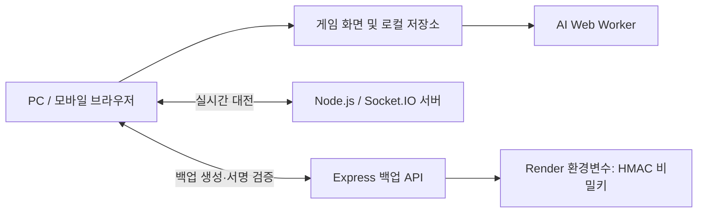

# 2048 Graduation — 확장형 2048 게임

> 수원대학교 컴퓨터학부 졸업작품 · 제작: 이상진  
> **스테이지 · 아이템 · AI 대전 · 실시간 1:1 멀티플레이 · 업적과 테마 · 데이터 백업/복원**

[🎮 게임 실행하기](https://two048-graduation.onrender.com) · [📁 GitHub 저장소](https://github.com/si839411-tech/2048-graduation)

## 1. 프로젝트 소개

기본 2048의 숫자 타일 결합 규칙을 확장해 다양한 조건의 스테이지와 성장 요소, AI 대전, 온라인 대전을 제공하는 웹 게임입니다. 플레이어는 방향키 또는 모바일 입력으로 같은 숫자의 타일을 합치고, 스테이지별 목표 점수를 달성합니다.

교육·졸업작품 시연을 목적으로 제작한 프로젝트입니다. 실제 서비스의 계정 인증, 경쟁 기록 검증, 결제 기능은 제공하지 않습니다.

### 주요 기능

- **총 23개 스테이지:** 기본 판부터 타이머·턴 제한·특수 형태의 보드·AI 대전까지 난이도별 진행
- **아이템 상점:** 플레이로 얻은 코인을 사용하여 16종의 강화 요소 구매
- **AI 대전:** 난이도에 따라 탐색 전략이 달라지는 자동 플레이 상대
- **실시간 멀티플레이:** Socket.IO를 이용한 1:1 매칭, 방 생성·참여, 초대 및 게임 상태 전달
- **업적과 테마:** 8개 업적을 달성해 8종의 테마 해금
- **PC·모바일 대응:** 화면 크기에 맞춘 배치 및 모바일 조작
- **데이터 백업·복원:** 브라우저 진행 기록을 서명된 JSON 파일로 저장하고 다른 PC에서 복원

## 2. 게임 방법

1. 메인 화면에서 **시작하기**를 선택합니다.
2. 해금된 스테이지를 선택하고 방향키로 타일을 이동시킵니다. 모바일에서는 게임 화면에 제공되는 터치 조작을 사용합니다.
3. 같은 값의 타일이 합쳐지면 점수가 증가합니다. 각 스테이지의 목표 점수를 달성하면 다음 스테이지를 해금할 수 있습니다.
4. 획득한 코인은 **상점**에서 사용합니다. **업적/꾸미기**를 통해 도전 목표와 해금 테마를 확인할 수 있습니다.
5. **멀티**에서는 다른 접속자와 매칭하거나 방에 입장해 대전할 수 있습니다.

스테이지마다 타일 생성 수, 이동 제한, 보드 크기, 장애물 및 타이머 규칙이 달라집니다. 실제 게임 화면의 스테이지 안내를 우선 확인해 주세요.

## 3. 스테이지 및 목표 점수

현재 코드(`script.js`의 `STAGE_GOALS`)에 설정된 점수입니다.

| 구분 | 스테이지별 목표 점수 | 특징 |
| --- | --- | --- |
| 1단계 | 1-1 **8**, 1-2 **300**, 1-3 **500**, 1-4 **700** | 기본 조작과 단계별 규칙 학습 |
| 2단계 | 2-1 **500**, 2-2 **700**, 2-3 **900**, 2-4 **1,200** | 제한 조건이 추가되는 도전 |
| 3단계 | 3-1 **1,300**, 3-2 **1,600**, 3-3 **1,900**, 3-4 **2,300** | 상승하는 난이도 |
| 4단계 | 4-1 **900**, 4-2 **1,200**, 4-3 **1,500**, 4-4 **1,900** | 시간 관련 규칙을 포함한 도전 |
| 5단계 | 5-1 **2,000**, 5-2 **2,800** | 일부 칸이 막힌 특수 보드 |
| 6단계 | 6-1 **3,000**, 6-2 **4,000** | 대형·특수 형태의 보드 |
| 7단계 | 7-1 **2,400** | AI와 타이머 조건을 활용한 대전 |
| 8단계 | 8-1 **2,200** | 4×4 보드, 단계별 AI 난이도 도전 |
| 9단계 | 9-1 **2,400** | 4×4 보드, 연속 도전형 AI 대전 |
| 멀티플레이 | **3,000** | 온라인 1:1 대전용 목표 점수 |

> 점수·보상·상점 가격은 게임 밸런스를 조정할 수 있도록 `script.js`에 모아 두었습니다. 표는 문서 작성 당시의 `main` 기준이며 추후 변경될 수 있습니다.

## 4. 상점과 코인

- 최초 플레이의 기본 코인은 **120코인**입니다.
- 스테이지를 완료하면 스테이지별로 정해진 코인을 획득합니다.
- **아이템 1~16**을 구매하여 게임 내 여러 보조 효과를 강화할 수 있습니다.
- **아이템 16(타이머 강화)**은 구매 1회당 0.1초의 시간을 추가하며, 현재 최대 구매 수량은 **1,000개**, 기본 가격은 **12코인/개**입니다.
- 7-1은 **5×5**, AI 이동 간격 **2초**이며, 한 번 이동할 때 플레이어와 AI 양측에 새 타일 **2개씩** 생성됩니다(빈 칸이 부족하면 가능한 만큼). **플레이어 타이머는 -50초 + 아이템16 레벨 × 0.1초**입니다. 입장에는 아이템16 **600레벨 이상**이 필요하며, Lv.600은 10초, Lv.700은 20초, Lv.1000은 50초입니다. **AI는 타이머 Lv.700(20초)과 아이템7의 타일 생성 효과(16/32/64, 50%/30%/20%)를 고정 적용**하며 플레이어의 상점 구매(점수 보너스·시작 아이템·타일 생성 등)에 영향을 받지 않습니다. AI와 플레이어 모두 유효하게 이동하면 타이머가 다시 충전됩니다. **8-1과 9-1은 4×4**이며, 양측 모두 한 번의 이동 후 새 타일 **2개(4/8/16, 각각 50%/30%/20%)**가 생성됩니다. 상점 업그레이드 효과는 두 모드의 플레이어와 AI 모두에게 적용하지 않습니다.
- 8-1·9-1의 AI는 **난이도 1~100에 따라 1.3초~0.6초** 간격으로 이동합니다(1~30 기존 방식, 31~60 가중치 방식, 61~100 시간 제한 Expectimax). 약 30초 안팎의 대전을 목표로 점수를 설정했지만 실제 종료 시간은 이동 속도와 판 상태에 따라 달라집니다.
- 테스트/시연용 **상점 초기화**, **모든 스테이지 언락**, **코인 +1,000**, **업적 초기화/전체 완료** 기능은 상점이 아니라 **옵션 → 게임 관리**에 있습니다.
- 업적은 초기화 시 0/8로 돌아가며, 초기 상태에서 같은 버튼을 누르면 8개 모두 달성 처리됩니다. 이때 코인·아이템·스테이지 기록은 유지됩니다. 초기화 이후에는 새로 발생한 플레이·구매·난이도 진행 이벤트에 따라 업적을 다시 얻을 수 있습니다.
- 상점 16개 아이템은 현재 선택한 테마 색상을 사용하며, 글자가 읽히도록 대비를 유지합니다.

코인과 아이템 정보는 기본적으로 접속한 브라우저의 로컬 저장소에 보관됩니다.

## 5. AI 시스템

AI의 목적은 고정된 정답 수순을 재생하는 것이 아니라 현재 보드에서 가능한 이동을 평가하여 다음 행동을 선택하는 것입니다.

| 난이도 범위 | AI 전략 |
| --- | --- |
| 1~30 | 상대적으로 단순한 이동 판단 |
| 31~60 | 보드 상태를 고려한 가중치 기반 휴리스틱 평가 |
| 61~100 | 시간·탐색 노드 수를 제한하는 **Expectimax** 탐색 |

상위 난이도는 `ai-worker.js`의 **Web Worker**에서 탐색하므로, 복잡한 계산이 메인 화면 렌더링을 오래 가로막지 않도록 구성했습니다. 탐색 깊이와 계산 예산에는 제한이 있으며, 특수 장애물이 포함된 상황에서는 근사 평가를 사용할 수 있습니다.

**참고:** 이 AI는 게임 규칙에 따라 수를 탐색하는 알고리즘입니다. 별도로 학습된 신경망이나 생성형 AI 모델을 사용하는 구조는 아닙니다.

## 6. 멀티플레이

실시간 통신은 **Node.js + Express + Socket.IO**로 처리합니다.

- 접속자 ID 지정
- 1:1 자동 매칭 및 매칭 취소
- 공개 방 목록, 방 생성·입장, 비공개 초대
- 상대방의 보드·점수·상태 및 특수 효과 전달
- 승패 결과 전달과 방 퇴장

서버는 실시간 접속과 방 상태를 메모리에서 관리합니다. 따라서 서버가 재시작되면 진행 중인 매칭과 방 정보는 유지되지 않습니다. 게임 결과와 클라이언트 상태를 완전히 검증하는 랭킹 서버는 아닙니다.

## 7. 업적과 꾸미기

총 **8개 업적**을 달성하면 각각 테마가 해금됩니다.

| 업적 | 달성 조건 | 보상 테마 |
| --- | --- | --- |
| 첫걸음 | 솔로 또는 멀티 첫 게임 시작 | 파스텔 |
| 초보 탈출 | 1-4 클리어 | 오션 |
| 새로운 도전자 | 8-1 해금 | 네온 |
| AI 도전자 | 9-1 난이도 25 이상 | 화염 |
| AI 정복자 | 9-1 난이도 50 이상 | 사이버 |
| 인공지능의 천적 | 8-1 및 9-1 모두 난이도 100 도달 | 다이아몬드 |
| 큰손 | 상점에서 누적 20,000코인 사용 | 황금 |
| 완벽한 수집가 | 아이템 1~16 모두 실제 최대치 달성 | 레인보우 |

기본 테마는 **클래식**이며, 조건을 만족한 테마는 게임과 메뉴 화면에 적용할 수 있습니다.

## 8. 데이터 저장·백업·복원

### 일반 저장

코인, 구매 아이템, 해금 스테이지, AI 기록, 업적 및 테마 등은 `localStorage`를 기반으로 저장됩니다. 회원가입이나 서버 데이터베이스는 사용하지 않습니다.

### 백업 방법

1. 게임에서 **옵션 → 데이터 백업**을 선택합니다.
2. 브라우저에 저장된 진행 기록이 서버로 전송됩니다.
3. 서버가 값의 형식을 검사하고 **HMAC-SHA256** 방식으로 서명합니다.
4. `2048-save-YYYY-MM-DD.json` 형식으로 백업 파일이 다운로드됩니다.

### 다른 PC에서 복원

1. 기존 PC에서 생성한 JSON 파일을 다른 PC로 옮깁니다.
2. 다른 PC에서 동일한 게임 사이트에 접속합니다.
3. **옵션 → 데이터 복원**을 선택하고 JSON 파일을 업로드합니다.
4. 서버가 서명을 확인하면 기존 로컬 기록을 덮어쓸지 묻습니다.
5. 확인 후 저장값을 적용하고 페이지를 다시 불러옵니다.

> **주의:** 복원은 다른 PC의 데이터를 자동으로 동기화하는 기능이 아닙니다. 같은 백업 파일을 여러 PC에서 복원할 수 있으며, 복원 후의 진행은 각 브라우저에서 독립적입니다. 브라우저 기록을 삭제하면 로컬 저장 데이터도 사라질 수 있습니다.

> **보안 한계:** 서명은 파일이 서명된 뒤 수정되었는지를 확인하는 용도입니다. 현재 공개 백업 API는 브라우저가 전송한 유효한 형식의 데이터에 서명하기 때문에, 게임 플레이 기록의 진위를 보증하거나 부정행위를 막지는 못합니다. 복원된 데이터는 암호화되어 있지 않습니다.

## 9. 기술 구성

| 영역 | 기술 |
| --- | --- |
| 프런트엔드 | HTML, CSS, JavaScript |
| AI 계산 | JavaScript, Web Worker, 휴리스틱 평가, Expectimax |
| 서버 | Node.js, Express 5 |
| 실시간 통신 | Socket.IO 4 |
| 저장 | 브라우저 `localStorage` |
| 백업 서명 | Node.js `crypto`, HMAC-SHA256 |
| 배포 | GitHub, Render |



## 10. 프로젝트 파일 구조

```text
2048-graduation/
├── index.html          # 화면 구성 및 기본 스타일
├── script.js           # 게임 진행, 스테이지, 코인, 상점, 화면 로직
├── game.js             # 게임 관련 별도 스크립트
├── mobile.js           # 모바일 입력·화면 대응
├── ai-worker.js        # AI 탐색용 Web Worker
├── achievements.js     # 업적 판정과 테마 해금
├── achievements.css    # 업적·테마 화면 스타일
├── backup.js           # 백업/복원 브라우저 UI
├── backup.css          # 백업/복원 UI 스타일
├── backup-api.js       # HMAC 서명·검증 API
├── server.js           # Express 정적 파일 제공 및 Socket.IO 서버
├── package.json        # npm 패키지 설정
├── package-lock.json   # 의존성 버전 고정
└── README.md           # 프로젝트 설명서
```

`node_modules/`는 의존성 설치 시 자동 생성되므로 보통 GitHub에 올리지 않습니다.

## 11. 로컬 실행

**준비:** Node.js 및 npm, Git이 설치되어 있어야 합니다.

```bash
git clone https://github.com/si839411-tech/2048-graduation.git
cd 2048-graduation
npm ci
```

백업·복원 기능까지 사용하려면 서버 환경변수 `BACKUP_HMAC_SECRET`에 **충분히 긴 무작위 문자열**을 설정해야 합니다. 비밀키는 GitHub에 업로드하지 않습니다.

Windows PowerShell 예시:

```powershell
$env:BACKUP_HMAC_SECRET = node -e "console.log(require('crypto').randomBytes(32).toString('hex'))"
npm start
```

터미널에 안내되는 포트(기본 **3000**)로 접속합니다.

- 로컬 주소: `http://localhost:3000`
- 실행 명령어: `npm start`
- 종료: 실행 중인 터미널에서 `Ctrl + C`

위 PowerShell 예시는 **해당 터미널 세션에서만** 환경변수를 설정합니다. 프로그램 재시작 후 예전 백업을 계속 복원하려면 동일한 비밀키를 안전하게 보관해 재사용해야 합니다.

## 12. Render 배포

1. GitHub 저장소를 Render의 **Web Service**에 연결합니다.
2. 설치 명령은 `npm install` 또는 `npm ci`, 실행 명령은 `npm start`로 설정합니다.
3. Render **Environment**에서 다음 환경변수를 등록합니다.

   | 이름 | 값 |
   | --- | --- |
   | `BACKUP_HMAC_SECRET` | 안전하게 생성한 무작위 비밀키 (32바이트 이상 권장) |

4. 변경사항을 저장하고 배포합니다.
5. 배포 후 실제 게임에서 백업 다운로드와 복원 검증을 확인합니다.

서버 포트는 `PORT` 환경변수가 있으면 그 값을 사용하고, 없으면 `3000`을 사용합니다.

**중요:** 비밀키를 교체하거나 잃어버리면 이전 키로 서명한 백업 파일은 검증할 수 없습니다. 비밀키를 코드, README, 커밋, 스크린샷에 포함하지 마세요.

## 13. 개발 시 주의사항과 한계

- 백업 HMAC은 **파일 무결성 검사**에 사용하며, 저장값의 진위나 사용자 신원을 검증하지 않습니다.
- 온라인 멀티플레이는 인증·서버 권위적 판정·치트 방지 시스템이 없는 **시연용** 구조입니다.
- 서버 재시작 시 메모리에 있던 방과 매칭 정보가 초기화됩니다.
- `localStorage`는 브라우저/도메인별 저장소이므로 다른 기기와 자동 동기화되지 않습니다.
- 의존성 및 보안 점검의 상세 내용은 별도로 제공한 `SECURITY_REVIEW.md`를 참고해 주세요.

## 14. 저작권과 라이선스

이 프로젝트는 2048 숫자 결합 게임을 기반으로 스테이지, AI 대전, 멀티플레이, 상점, 업적 및 백업·복원 기능을 구현한 교육용 졸업작품입니다.

- **프로젝트 자체 코드:** 공개 저장소이지만 `package.json`의 `UNLICENSED` 설정에 따라 제3자에게 별도의 사용·복제·수정·재배포 라이선스를 부여하지 않습니다. 허가가 필요한 경우 권리자에게 문의해야 합니다.
- **원작 2048:** Gabriele Cirulli의 [2048](https://github.com/gabrielecirulli/2048)은 MIT 라이선스입니다. 원작 코드나 창작적 자산을 실제로 재사용한 경우 해당 저작권 및 라이선스 고지를 유지해야 합니다. 게임 규칙에서 영감을 받았다는 사실만으로 원작 소스 코드를 사용했다고 단정하지 않습니다.
- **타사 라이브러리:** Express, Socket.IO 및 npm 의존성에는 각각의 별도 라이선스가 적용됩니다. 자세한 내용은 `THIRD_PARTY_NOTICES.md`를 참고하세요.
- **npm 배포 방지:** `private: true`는 npm 게시를 차단하지만 GitHub 공개나 웹 서비스 실행을 차단하지 않습니다.

이 설정은 **자체 코드의 이용 허락 범위**에 관한 것이며, 외부 코드에 이미 적용되는 라이선스 의무를 없애지 않습니다. 원작 코드·이미지·폰트 등을 복사하여 사용했다면 실제 사용 내역을 확인하고 고지와 필요한 라이선스 원문을 추가해야 합니다.

---

**문서 기준일:** 2026-11-08 · **대상:** GitHub `main`에서 확인한 V19 계열 코드. 실제 배포 버전이나 이후 수정에 따라 기능·수치가 달라질 수 있습니다.


## V22 추가 변경

- 7-1 스테이지를 **보스전 느낌의 전용 UI**로 조정
  - 상단에 `FINAL BOSS STAGE` 헤더 추가
  - 플레이어 패널과 보스 패널의 색상/배경 분리
  - 7-1 전용 타일, 타이머 바, 패널 디자인 강화
  - 8-1, 9-1의 AI 난이도 스테이지 디자인은 유지
- 상점 가격 소폭 조정
  - 아이템7: **1400 → 1600 코인**
  - 아이템8: **2200 → 2500 코인**


## V23: 7-1 보스 AI 행동 패턴 (학습 모델 도입 전 단계)

- 7-1 AI 이동 간격을 **0.3~18.5초** 범위에서 행동마다 새롭게 선택하며, 불규칙하게 움직입니다. 기존에 요청한 0.3~19.9초 범위 안에 있으며 AI의 20초 이동 타이머에서 **최소 1.5초의 안전 여유**를 확보했습니다.
- 보스 상태 4개: **일반(0.8~2.5초, 기본 55%)**, **폭주(0.3~0.8초, 25%)**, **분석(2.5~6초, 17%)**, **충전(6~18.5초, 3%)**. 실제 확률은 점수 차이 및 남은 빈칸에 따라 달라집니다.
- 보스 상태는 PC에서는 AI 패널, 모바일에서는 플레이어의 화면 상단에 표시됩니다. 폭주·분석·충전 시에는 패널 테두리 연출을 적용합니다.
- 7-1 보스는 일반·폭주 때 **가중치 기반 판단**, 분석·충전 때 **기존 Expectimax Web Worker**를 사용합니다. 아직 N-Tuple 학습 가중치를 사용하지는 않으며 이후 학습형 보스 AI 도입을 예정하고 있습니다.
- 8-1/9-1은 기존 이동 간격·난이도·게임 규칙을 유지합니다.

- PC/모바일 보스 화면의 상단 잘림, 안내 배지 겹침, 타이머 바 가로 넘침, 아이템 슬롯과 보스 패널 겹침을 보정했습니다.


## V24 추가 변경

- 7-1 보스전 디자인을 기존 게임 테마에 더 가깝게 조정
- 어두운 붉은 보스전 배경을 제거하고 기존 연녹색 계열 중심으로 통일
- 보스/플레이어 구분은 유지하되 색 대비를 완화해 이질감을 줄임
- 보스 상태 배지와 타이머 강조 효과도 더 부드럽게 수정
